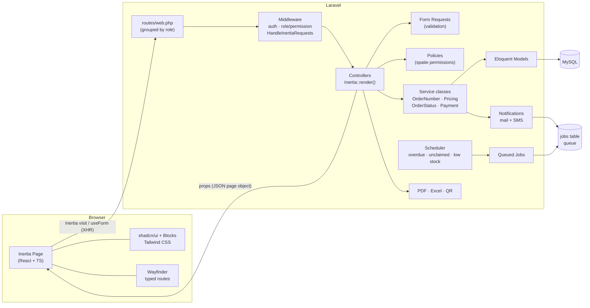
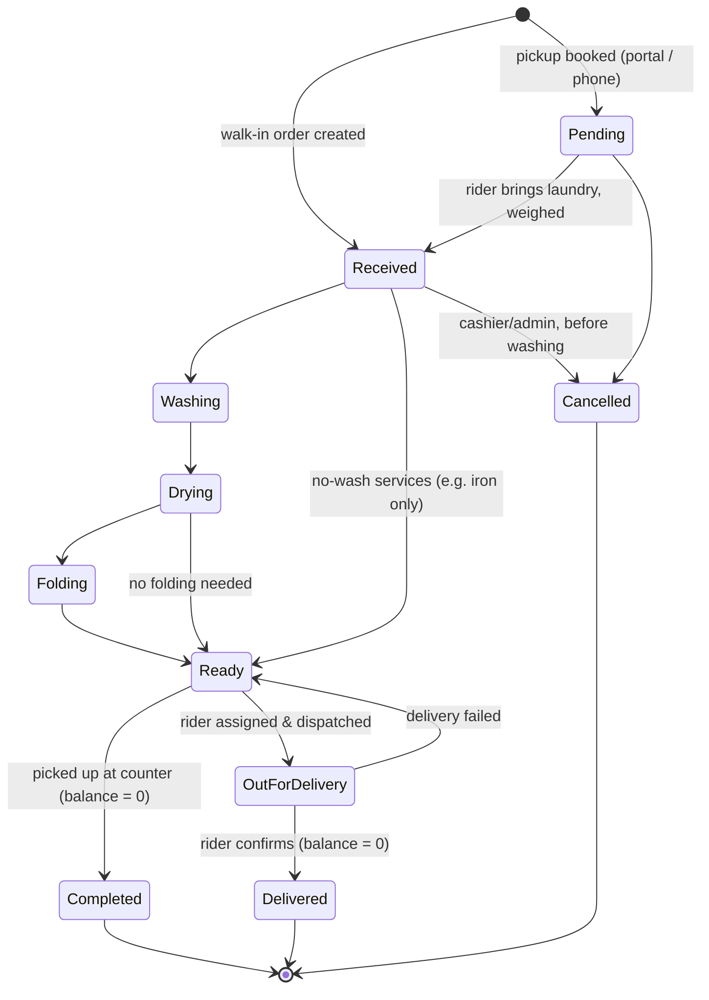
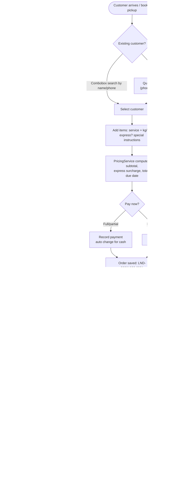

# Phase 1 — System Planning

**Project:** Digital Laundry Order Recording and Processing System
**Stack:** Laravel 13 · Inertia.js v3 · React 19 + TypeScript · shadcn/ui · Tailwind CSS v4 · MySQL
**Status:** Draft for approval

---

## 1. Starting point (existing codebase audit)

`systemlaundry/` is the official **Laravel React Starter Kit**. We are keeping most of it and replacing some parts.

| Already present                                                        | Decision                                                                                                                                          |
| ---------------------------------------------------------------------- | ------------------------------------------------------------------------------------------------------------------------------------------------- |
| Database server: **XAMPP MariaDB 10.4**                                | **Use it**, through Laravel's `mariadb` driver (see R1)                                                                                           |
| Fortify auth (login, reset, 2FA, passkeys)                             | **Keep.** Restyle the login page with the shadcn `login-03` block. Turn off public registration, because staff accounts are created by the Admin. |
| shadcn `sidebar`, `breadcrumb`, `card`, `dialog`, `sheet`, `sonner`, … | **Keep.** Add the missing components (see §7).                                                                                                    |
| Inertia v3 + React 19 + React Compiler                                 | **Keep.**                                                                                                                                         |
| **Wayfinder** (typed, generated route helpers)                         | **Recommended over Ziggy** (see §8, Q1).                                                                                                          |
| **Teams** (multi-tenant, `/{current_team}/dashboard`)                  | **Remove.** One shop needs no tenancy. Teams roles would also clash with `spatie/laravel-permission`.                                             |
| SQLite in `.env`                                                       | Switch to **MySQL 8** (see §9, risk R1).                                                                                                          |
| PHPUnit 12                                                             | **Keep PHPUnit** (Pest is optional, see §8, Q3).                                                                                                  |
| Appearance (light/dark/system)                                         | **Keep.** It already uses shadcn CSS variables.                                                                                                   |

---

## 2. Architecture overview



**Request lifecycle (one example):** the cashier submits New Order → `useForm().post(store())` → `StoreOrderRequest` validates (errors come back as `errors.field` under each shadcn input) → `OrderController@store` calls `OrderService::create()` inside one DB transaction. That call generates the order number, computes the price, writes the items and the first status history row, and records any payment. → The controller redirects to `orders.show` with a flash message, which Sonner shows as a toast.

**Architecture rules**

1. **Controllers stay thin.** Business rules live in `app/Services`. Controllers, scheduled jobs and tests all call the same services, so the rules are written once.
2. **No separate REST API for pages.** Every page is an Inertia response. There is one deliberate exception: a small JSON endpoint `GET /search` for the Ctrl+K command palette and the customer combobox. These need typeahead results on each keystroke, not a full page visit.
3. **Enums for fixed vocabularies.** `OrderStatus`, `PaymentMethod`, `PaymentStatus`, `PricingUnit`, `DeliveryType` and `StockMovementType` are PHP backed enums. TypeScript types are generated from them so both sides match.
4. **Order status is a state machine.** Status changes only through `OrderStatusService::transition()`. That method checks that the move is allowed, writes `order_status_histories`, logs the activity, and sends any notification.
5. **Prices are copied onto the order.** `order_items` store `unit_price` as it was when the order was made. If a service's price changes later, old orders and receipts stay correct. This is recorded history, not a 3NF violation.
6. **Money is stored as `DECIMAL(10,2)`**, never float.
7. **"Real-time" means polling.** The status board and the customer tracking page refresh with Inertia `usePoll` every 15 s. It is simple and reliable for a capstone. Laravel Reverb (WebSockets) is an optional upgrade later.

---

## 3. User roles and permissions

Roles and permissions use `spatie/laravel-permission`. Permissions are fine-grained, and each role is a bundle of permissions, so the Admin can adjust what a role can do without code changes.

| Permission                             | Admin |       Cashier       | Laundry Staff |     Rider      | Customer |
| -------------------------------------- | :---: | :-----------------: | :-----------: | :------------: | :------: |
| `dashboard.view-analytics`             |  ✅   |                     |               |                |          |
| `customers.view` / `create` / `update` |  ✅   |         ✅          |     view      |                |          |
| `customers.delete`                     |  ✅   |                     |               |                |          |
| `orders.view`                          |  ✅   |         ✅          |      ✅       |    assigned    |   own    |
| `orders.create` / `update`             |  ✅   |         ✅          |               |                |   book   |
| `orders.cancel`                        |  ✅   | ✅ (before washing) |               |                |          |
| `orders.update-status`                 |  ✅   |         ✅          |      ✅       | delivery steps |          |
| `payments.create`                      |  ✅   |         ✅          |               |    ✅ (COD)    |          |
| `payments.void`                        |  ✅   |                     |               |                |          |
| `deliveries.assign`                    |  ✅   |         ✅          |               |                |          |
| `deliveries.update`                    |  ✅   |                     |               |    assigned    |          |
| `services.manage`                      |  ✅   |                     |               |                |          |
| `inventory.view`                       |  ✅   |         ✅          |      ✅       |                |          |
| `inventory.manage`                     |  ✅   |                     |   stock-out   |                |          |
| `reports.view` / `export`              |  ✅   |    daily summary    |               |                |          |
| `users.manage`                         |  ✅   |                     |               |                |          |
| `activity-log.view`                    |  ✅   |                     |               |                |          |
| `settings.manage`                      |  ✅   |                     |               |                |          |

---

## 4. Module breakdown and use cases

| #   | Module                           | Covers features            | Main use cases                                                                                                                                                                  |
| --- | -------------------------------- | -------------------------- | ------------------------------------------------------------------------------------------------------------------------------------------------------------------------------- |
| M1  | **Auth & Access**                | 20                         | Log in, log out, reset password; Admin creates, deactivates and assigns roles to staff                                                                                          |
| M2  | **Customers**                    | 1                          | Register a customer (phone number must be unique to stop duplicates), search, edit, view order and payment history                                                              |
| M3  | **Services & Pricing**           | 4, 5, 19                   | Manage services (Wash, Dry, Fold, Iron, Dry Clean, Comforter…), pricing unit (per kg / per item), minimum kg, turnaround hours, express surcharge                               |
| M4  | **Orders**                       | 2, 3, 4, 9, 10, 17, 18, 19 | New order in under 30 s: pick customer, add items, set express, pick schedule, add instructions, take payment → auto order number, totals and change → print receipt and QR tag |
| M5  | **Processing**                   | 6, 17                      | Staff move orders through the statuses from a status board or by **scanning the QR tag**. Each move is time-stamped with the user who made it.                                  |
| M6  | **Payments**                     | 8, 9, 12                   | Record cash, e-wallet, bank or card payments, including partial and pay-at-pickup; automatic change; void (Admin only, reason required); payment history                        |
| M7  | **Pickup & Delivery**            | 7, 13                      | Schedule pickup or delivery slots, assign a rider, rider marks picked up / delivered / failed, cash-on-delivery collection                                                      |
| M8  | **Notifications**                | 11, 22                     | Queued mail and SMS on: order received, ready for pickup, out for delivery, delivered, unclaimed reminder. Every message is logged.                                             |
| M9  | **Monitoring**                   | 14, 22                     | Overdue list (past due and not ready); unclaimed list (ready for more than X days) with automatic reminders                                                                     |
| M10 | **Inventory**                    | 23                         | Supplies (detergent, softener, bags…), stock in / out / adjust records, low-stock alert                                                                                         |
| M11 | **Reports & Analytics**          | 15, 16, 24, 25             | Daily summary, sales, pending orders, completed services, staff activity; charts for sales trend, peak hours, top services and top customers; PDF and Excel export              |
| M12 | **Audit Trail**                  | 21                         | Who changed what and when (spatie activitylog), with before/after values                                                                                                        |
| M13 | **Settings**                     | —                          | Shop profile (name, address, logo, contact), currency, express surcharge %, unclaimed days, receipt footer, notification switches                                               |
| M14 | **Customer Portal** _(optional)_ | —                          | Book a pickup, track an order, view history (see Q4)                                                                                                                            |

### Use cases per role

**Admin / Owner**

- Sees the analytics dashboard (KPIs, charts, recent orders)
- Manages services and prices, users and roles, settings and inventory
- Views and exports all reports; reviews the activity log
- Voids payments and cancels orders at any stage (a reason is required)

**Cashier / Front Desk**

- Searches for or creates a customer, then creates an order
- Collects payment and prints the receipt and QR tag
- Releases finished laundry: confirms the balance is zero, then marks the order _Completed_
- Schedules pickups and deliveries and assigns riders
- Watches the overdue and unclaimed lists; resends notifications
- Views the day's transaction summary at closing

**Laundry Staff**

- Scans an order's QR tag, then taps the big _Move to {next status}_ button
- Uses the status board (columns per status) to see the workload
- Records supply usage (stock-out)

**Delivery Rider**

- Sees today's assigned pickups and deliveries (mobile-first list)
- Updates each one to _Picked up_, _Delivered_ or _Failed (reason)_
- Records cash-on-delivery payments

**Customer** _(optional portal)_

- Books a pickup, tracks order status in real time, views past orders and receipts

---

## 5. Order workflow

### 5.1 Status state machine



I added three statuses that the brief does not list:

- **Pending (For Pickup)** — a booked pickup exists as an order before the laundry reaches the shop (added in Phase 2).
- **Out for Delivery** — without it the system cannot show which orders are with a rider at the moment.
- **Cancelled** — orders do get cancelled, and they must stay on record instead of being deleted.

Business rules enforced in `OrderStatusService`:

- Orders only move forward, except a **failed delivery**, which goes back to _Ready_.
- An order cannot become **Completed** or **Delivered** while it still has a balance. Admin can override this, and the override goes to the audit log with a reason.
- The **weight** of a per-kg order can be corrected only while the order is _Received_. The total is then recalculated and the correction is logged.
- **Payment status** (`unpaid`, `partial`, `paid`) is tracked separately from order status. It is recomputed from the `payments` table every time a payment is added or voided.

### 5.2 End-to-end flow



### 5.3 Order number generation

The format is `LND-YYYYMMDD-NNNN`, and the counter starts again at 0001 each day.

**Risk:** the naive approach, `MAX(order_number) + 1`, produces **duplicate numbers when two cashiers save at the same moment**. That is exactly the peak-hour situation this system is meant to handle.

**Plan:** use an `order_sequences` table (`date` as primary key, `last_number`). Inside the order transaction we run `SELECT … FOR UPDATE` on today's row and increment it. A `UNIQUE` index on `orders.order_number` is the final safety net.

### 5.4 QR tags and tracking

There are two separate codes, for security:

- **Staff QR tag**, printed on the laundry bag. It encodes `/scan/{order_number}` and requires a logged-in user with `orders.update-status`.
- **Customer tracking link**, sent by SMS or email. It uses a random 12-character `tracking_code` (`/track/{code}`). Order numbers are sequential, so anyone could guess them; using them in public links would let one customer see another customer's orders.

---

## 6. Folder structure

The new files follow the starter kit's existing conventions. Inside `resources/js`, **file names are kebab-case** (as the shadcn CLI generates them), while **component names are PascalCase**.

```
systemlaundry/
├── app/
│   ├── Console/Commands/
│   │   ├── FlagOverdueOrders.php
│   │   ├── SendUnclaimedReminders.php
│   │   └── CheckLowStock.php
│   ├── Enums/
│   │   ├── OrderStatus.php            # labels, colors, allowed transitions
│   │   ├── PaymentMethod.php
│   │   ├── PaymentStatus.php
│   │   ├── PricingUnit.php
│   │   ├── DeliveryType.php
│   │   └── StockMovementType.php
│   ├── Exports/                       # maatwebsite/excel
│   │   ├── SalesReportExport.php
│   │   ├── OrdersReportExport.php
│   │   └── StaffActivityExport.php
│   ├── Http/
│   │   ├── Controllers/
│   │   │   ├── DashboardController.php
│   │   │   ├── CustomerController.php
│   │   │   ├── OrderController.php
│   │   │   ├── OrderStatusController.php
│   │   │   ├── OrderReceiptController.php   # print view + PDF
│   │   │   ├── OrderTagController.php       # QR tag
│   │   │   ├── ScanController.php
│   │   │   ├── PaymentController.php
│   │   │   ├── DeliveryController.php
│   │   │   ├── Rider/MyDeliveryController.php
│   │   │   ├── ServiceController.php
│   │   │   ├── InventoryItemController.php
│   │   │   ├── StockMovementController.php
│   │   │   ├── MonitoringController.php     # overdue + unclaimed
│   │   │   ├── ReportController.php
│   │   │   ├── UserController.php
│   │   │   ├── ActivityLogController.php
│   │   │   ├── SearchController.php         # JSON for Ctrl+K / combobox
│   │   │   ├── TrackingController.php       # public /track/{code}
│   │   │   ├── Portal/…                     # optional customer portal
│   │   │   └── Settings/ (existing + ShopSettingController.php)
│   │   ├── Middleware/HandleInertiaRequests.php  # shares auth, roles, permissions, flash, settings
│   │   └── Requests/  (Store*/Update* per resource)
│   ├── Jobs/SendOrderReminder.php
│   ├── Models/
│   │   ├── User.php  Customer.php  Service.php
│   │   ├── Order.php  OrderItem.php  OrderStatusHistory.php  OrderSequence.php
│   │   ├── Payment.php  Delivery.php
│   │   ├── InventoryItem.php  StockMovement.php
│   │   ├── NotificationLog.php  Setting.php
│   ├── Notifications/
│   │   ├── Channels/SmsChannel.php     # driver interface: log | semaphore | twilio
│   │   ├── OrderReceived.php  OrderReady.php  OrderOutForDelivery.php
│   │   ├── OrderDelivered.php  UnclaimedReminder.php  LowStockAlert.php
│   ├── Policies/  (OrderPolicy, CustomerPolicy, PaymentPolicy, DeliveryPolicy, …)
│   └── Services/
│       ├── OrderNumberGenerator.php
│       ├── PricingService.php          # subtotal, express surcharge, min kg, due date
│       ├── OrderService.php            # create/update inside transactions
│       ├── OrderStatusService.php      # state machine + history + notifications
│       ├── PaymentService.php          # apply, change, void, recompute status
│       ├── DeliveryService.php
│       ├── InventoryService.php
│       ├── ReportService.php           # aggregate queries shared by pages & exports
│       └── Sms/ (SmsGateway interface + drivers)
├── database/
│   ├── migrations/  factories/  seeders/ (RolePermissionSeeder, ServiceSeeder, DemoDataSeeder)
├── resources/
│   ├── views/
│   │   ├── app.blade.php
│   │   └── pdf/ receipt.blade.php · qr-tag.blade.php · report.blade.php
│   ├── css/app.css                     # shadcn theme tokens + status colors
│   └── js/
│       ├── app.tsx
│       ├── components/
│       │   ├── ui/                     # shadcn generated — never hand-edited
│       │   ├── data-table/             # data-table.tsx, column-header, toolbar,
│       │   │                           # pagination, view-options, faceted-filter
│       │   ├── app-sidebar.tsx         # role-based menu (sidebar block)
│       │   ├── command-menu.tsx        # Ctrl+K global search
│       │   ├── status-badge.tsx
│       │   ├── order-stepper.tsx
│       │   ├── customer-combobox.tsx
│       │   ├── confirm-dialog.tsx
│       │   ├── page-header.tsx
│       │   ├── stat-card.tsx
│       │   ├── money.tsx
│       │   └── date-picker.tsx
│       ├── hooks/                      # use-permission.ts, use-flash-toast.ts (existing)…
│       ├── layouts/
│       │   ├── app-layout.tsx          # sidebar block layout
│       │   ├── auth-layout.tsx         # login block
│       │   └── print-layout.tsx        # receipt / tag printing
│       ├── lib/ (utils.ts, format.ts — currency/date)
│       ├── pages/
│       │   ├── auth/login.tsx
│       │   ├── dashboard.tsx
│       │   ├── orders/      index.tsx · create.tsx · show.tsx · board.tsx · receipt.tsx · tag.tsx
│       │   ├── scan/        show.tsx
│       │   ├── customers/   index.tsx · show.tsx
│       │   ├── payments/    index.tsx
│       │   ├── deliveries/  index.tsx
│       │   ├── rider/       deliveries.tsx
│       │   ├── monitoring/  overdue.tsx · unclaimed.tsx
│       │   ├── services/    index.tsx
│       │   ├── inventory/   index.tsx · show.tsx
│       │   ├── reports/     index.tsx · daily.tsx · sales.tsx · staff.tsx
│       │   ├── users/       index.tsx
│       │   ├── activity-log/index.tsx
│       │   ├── settings/    profile.tsx · security.tsx · appearance.tsx · shop.tsx
│       │   ├── track/       show.tsx      # public tracking
│       │   └── portal/      …             # optional
│       └── types/  (index.d.ts, models.ts, enums.ts)
├── routes/
│   ├── web.php          # grouped by role/permission
│   ├── settings.php
│   └── console.php      # schedule: overdue (hourly), unclaimed (daily 09:00), low stock (daily)
└── tests/Feature/       # Orders, Payments, Status, Deliveries, Reports, Permissions
```

---

## 7. shadcn install plan

These are installed during Phase 5. Components that are already present are skipped.

```bash
# Blocks
npx shadcn@latest add login-03 sidebar-07 dashboard-01

# Components not yet in components/ui
npx shadcn@latest add calendar chart command popover table tabs textarea \
  radio-group switch progress pagination hover-card scroll-area resizable \
  alert-dialog drawer context-menu accordion form

# Data table dependency
npm install @tanstack/react-table
```

Backend packages (Phase 2/3):

```bash
composer require spatie/laravel-permission spatie/laravel-activitylog \
  barryvdh/laravel-dompdf maatwebsite/excel simplesoftwareio/simple-qrcode
```

---

## 8. Decisions needed before Phase 2

| #   | Question                                                                                                                                                     | Recommendation                                                                                                                                                               |
| --- | ------------------------------------------------------------------------------------------------------------------------------------------------------------ | ---------------------------------------------------------------------------------------------------------------------------------------------------------------------------- |
| Q1  | **Wayfinder vs Ziggy.** The brief names Ziggy, but the starter kit already uses Wayfinder, which gives typed route functions generated from the controllers. | **Use Wayfinder.** It does the same job with type safety and is already wired in. Adding Ziggy too would mean two route systems.                                             |
| Q2  | **Remove the Teams feature?**                                                                                                                                | **Yes.** Single shop. If multiple branches are needed later, add a `branches` table and `branch_id` columns.                                                                 |
| Q3  | **Pest or PHPUnit?**                                                                                                                                         | **PHPUnit** (already configured). Pest can be added if your adviser prefers it.                                                                                              |
| Q4  | **Include the Customer Portal?**                                                                                                                             | **Include a minimal version**: book a pickup, track, history. Public tracking via `/track/{code}` is built either way.                                                       |
| Q5  | **Currency and SMS provider?**                                                                                                                               | Currency is set in Settings. The SMS layer uses a driver interface with a `log` driver for development. Tell me which gateway you will use (e.g. Semaphore, Twilio, Vonage). |
| Q6  | **Discounts** (e.g. promo, loyalty, senior citizen)?                                                                                                         | Not in the brief. A simple per-order discount with a reason is easy to add now and awkward to add later.                                                                     |

---

## 9. Risks and mitigations

| #   | Risk                                                                                                     | Mitigation                                                                                                                                                                                                                                                                                      |
| --- | -------------------------------------------------------------------------------------------------------- | ----------------------------------------------------------------------------------------------------------------------------------------------------------------------------------------------------------------------------------------------------------------------------------------------- |
| R1  | The database server is **XAMPP's MariaDB 10.4**, which is end-of-life and lacks some newer SQL features. | Use Laravel's `mariadb` driver (`DB_CONNECTION=mariadb`, database `laundry_system`). It already falls back to compatible SQL for older servers (`char(36)` UUIDs, `CHANGE COLUMN` renames). Migrations also avoid newer features: no native `uuid` type, no `RETURNING`, no functional indexes. |
| R2  | Duplicate order numbers under concurrent saves                                                           | Locked sequence row plus a unique index (§5.3)                                                                                                                                                                                                                                                  |
| R3  | Duplicate or misspelled customers                                                                        | Search-first combobox; phone number normalized and unique; "possible duplicate" warning on similar names                                                                                                                                                                                        |
| R4  | Price changes corrupting old receipts                                                                    | Copy the price onto each order item (§2, rule 5)                                                                                                                                                                                                                                                |
| R5  | Notifications slowing down the counter                                                                   | All mail and SMS are **queued**; `queue:work` runs as a service                                                                                                                                                                                                                                 |
| R6  | Scheduler not running in production                                                                      | Document a cron / Task Scheduler entry for `schedule:run` (Phase 6)                                                                                                                                                                                                                             |
| R7  | Guessable public tracking URLs                                                                           | Random `tracking_code`, not the order number (§5.4)                                                                                                                                                                                                                                             |
| R8  | Report queries slow as data grows                                                                        | Indexes on `orders(status, due_at)`, `orders(created_at)`, `payments(paid_at)`; aggregation in `ReportService`                                                                                                                                                                                  |

---

## 10. Development roadmap

| Phase | Output                                                                                             | Est.    |
| ----- | -------------------------------------------------------------------------------------------------- | ------- |
| 1     | This plan                                                                                          | ✅      |
| 2     | Database: tables, ERD, migrations, models, factories, seeders                                      | 1 wk    |
| 3     | Backend: routes, controllers, requests, policies, services, notifications, scheduler, PDF/QR/Excel | 2–3 wks |
| 4     | UI/UX spec: theme, status colors, page-by-page component map                                       | 0.5 wk  |
| 5     | Frontend: layout, shared components, all pages, receipt, charts                                    | 3 wks   |
| 6     | Feature tests, edge cases, deployment guide                                                        | 1 wk    |
