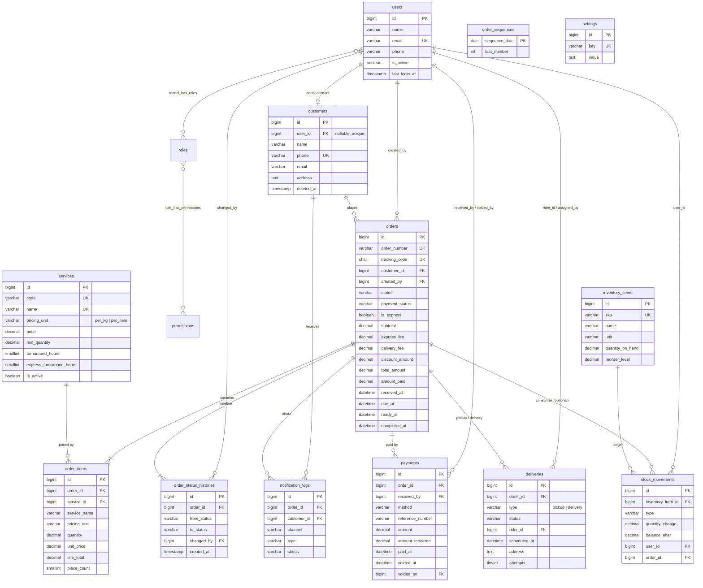

# Phase 2 — Database Design

**Server:** XAMPP MariaDB 10.4 · Laravel `mariadb` driver · `utf8mb4_unicode_ci` · InnoDB
**Database:** `laundry_system`

---

## 1. Design principles

1. **Third normal form (3NF).** Every non-key column depends on the key, the whole key, and nothing but the key. Lookups (services, users, customers) live in their own tables and are referenced by foreign key.
2. **Fixed vocabularies are PHP backed enums stored as `VARCHAR`**, not MySQL `ENUM`. Adding a new status then needs no `ALTER TABLE`, and Laravel casts the column straight to the enum.
3. **Money is `DECIMAL(10,2)`; weights and quantities are `DECIMAL(8,2)`.** Never `FLOAT`, because floating-point rounding errors would appear in totals.
4. **Records are never deleted when history depends on them.**
    - Orders are _cancelled_, not deleted.
    - Payments are _voided_, not deleted.
    - Staff are _deactivated_ (`is_active = 0`).
    - Customers and services are soft-deleted or deactivated.
    - Foreign keys that point at financial history use `ON DELETE RESTRICT`.
5. **Snapshots are deliberate, not redundancy.** Three cases look like duplicated data but record a fact at a point in time:
    - `order_items.service_name` and `order_items.unit_price` hold the price that was charged, even if the service is later renamed or repriced.
    - `deliveries.address` holds where this delivery went, even if the customer's address changes.
    - `stock_movements.balance_after` is a running ledger balance, the way a bank statement shows one.
6. **Controlled caches.** Three columns could be computed from child rows:
    - `orders.amount_paid` and `orders.payment_status` (from `payments`)
    - `inventory_items.quantity_on_hand` (from `stock_movements`)

    They are stored because list pages must filter and sort on them without aggregating thousands of rows. Only one service class writes each column, always in the same DB transaction as the child row. A feature test (Phase 6) checks that the cache equals the computed value. This is the one documented exception to 3NF.

---

## 2. Entity-relationship diagram

Package tables are not drawn: `roles`, `permissions` and the three pivots come from spatie/laravel-permission; `activity_log` from spatie/laravel-activitylog; `notifications` is Laravel's in-app (database) notifications table. Framework tables (`sessions`, `cache`, `jobs`, `password_reset_tokens`, `passkeys`) are also left out.

---

## 3. Table definitions

Every table has `id BIGINT UNSIGNED AUTO_INCREMENT PK` and `created_at` / `updated_at TIMESTAMP NULL`, unless noted otherwise.

### 3.1 `users` (extends the starter-kit table)

| Column                                | Type         | Constraints        | Notes                         |
| ------------------------------------- | ------------ | ------------------ | ----------------------------- |
| name                                  | VARCHAR(255) | NOT NULL           |                               |
| email                                 | VARCHAR(255) | UNIQUE, NOT NULL   | Login ID                      |
| phone                                 | VARCHAR(20)  | NULL               | Staff contact; riders need it |
| is_active                             | TINYINT(1)   | NOT NULL DEFAULT 1 | Deactivate instead of delete  |
| last_login_at                         | TIMESTAMP    | NULL               | Staff activity report         |
| password, remember_token, 2FA columns | —            | —                  | From the starter kit          |

The role (admin, cashier, staff, rider, customer) is stored in spatie's `model_has_roles`, not as a column on `users`.

### 3.2 `customers`

| Column     | Type            | Constraints                                 | Notes                                                       |
| ---------- | --------------- | ------------------------------------------- | ----------------------------------------------------------- |
| user_id    | BIGINT UNSIGNED | NULL, UNIQUE, FK → users ON DELETE SET NULL | Set only when the customer has a portal login               |
| name       | VARCHAR(150)    | NOT NULL, INDEX                             | Searched by the combobox                                    |
| phone      | VARCHAR(20)     | **UNIQUE**, NOT NULL                        | Normalized to `09XXXXXXXXX`; **blocks duplicate customers** |
| email      | VARCHAR(255)    | NULL                                        | For email notifications                                     |
| address    | TEXT            | NULL                                        | Default pickup/delivery address                             |
| notes      | TEXT            | NULL                                        | e.g. "allergic to scented softener"                         |
| deleted_at | TIMESTAMP       | NULL                                        | Soft delete                                                 |

### 3.3 `services`

| Column                   | Type              | Constraints         | Notes                                          |
| ------------------------ | ----------------- | ------------------- | ---------------------------------------------- |
| code                     | VARCHAR(20)       | UNIQUE              | Short code for fast keyboard entry, e.g. `WDF` |
| name                     | VARCHAR(100)      | UNIQUE              | "Wash, Dry & Fold"                             |
| description              | TEXT              | NULL                |                                                |
| pricing_unit             | VARCHAR(10)       | NOT NULL            | `per_kg` or `per_item`                         |
| price                    | DECIMAL(10,2)     | NOT NULL, ≥ 0       | Price per kg or per piece                      |
| min_quantity             | DECIMAL(8,2)      | NOT NULL DEFAULT 0  | Minimum charge, e.g. 3 kg                      |
| turnaround_hours         | SMALLINT UNSIGNED | NOT NULL DEFAULT 48 | Normal due time                                |
| express_turnaround_hours | SMALLINT UNSIGNED | NULL                | NULL = express not offered                     |
| is_active                | TINYINT(1)        | DEFAULT 1           | Inactive services are hidden from New Order    |
| sort_order               | SMALLINT UNSIGNED | DEFAULT 0           | Display order                                  |

### 3.4 `orders`

| Column               | Type             | Constraints               | Notes                                                    |
| -------------------- | ---------------- | ------------------------- | -------------------------------------------------------- |
| order_number         | VARCHAR(20)      | **UNIQUE**                | `LND-20261023-0001`                                      |
| tracking_code        | CHAR(12)         | **UNIQUE**                | Random code for the public tracking link                 |
| customer_id          | BIGINT UNSIGNED  | FK → customers RESTRICT   |                                                          |
| created_by           | BIGINT UNSIGNED  | NULL, FK → users RESTRICT | Cashier, or the customer for portal bookings             |
| status               | VARCHAR(20)      | NOT NULL, INDEX           | `OrderStatus` enum                                       |
| payment_status       | VARCHAR(10)      | NOT NULL DEFAULT `unpaid` | Cache (§1.6)                                             |
| is_express           | TINYINT(1)       | DEFAULT 0                 |                                                          |
| subtotal             | DECIMAL(10,2)    | DEFAULT 0                 | Σ order_items.line_total at checkout                     |
| express_fee          | DECIMAL(10,2)    | DEFAULT 0                 | subtotal × express % (setting)                           |
| delivery_fee         | DECIMAL(10,2)    | DEFAULT 0                 |                                                          |
| discount_amount      | DECIMAL(10,2)    | DEFAULT 0                 |                                                          |
| discount_reason      | VARCHAR(255)     | NULL                      | Required when there is a discount (validated in Phase 3) |
| total_amount         | DECIMAL(10,2)    | DEFAULT 0                 | subtotal + express_fee + delivery_fee − discount         |
| amount_paid          | DECIMAL(10,2)    | DEFAULT 0                 | Cache (§1.6)                                             |
| special_instructions | TEXT             | NULL                      |                                                          |
| received_at          | DATETIME         | NULL                      | NULL while a booked pickup has not reached the shop yet  |
| due_at               | DATETIME         | NULL                      |                                                          |
| ready_at             | DATETIME         | NULL                      | Start of the unclaimed countdown                         |
| completed_at         | DATETIME         | NULL                      | Claimed or delivered                                     |
| cancelled_at         | DATETIME         | NULL                      |                                                          |
| cancellation_reason  | VARCHAR(255)     | NULL                      |                                                          |
| last_reminded_at     | DATETIME         | NULL                      | Unclaimed reminders                                      |
| reminder_count       | TINYINT UNSIGNED | DEFAULT 0                 |                                                          |

**Indexes:** `(status, due_at)` for the overdue list, `(status, ready_at)` for the unclaimed list, `(created_at)` for reports, `(customer_id)`.

`total_amount` and `subtotal` are stored, not computed, because a receipt is a legal document: it must show what was charged at that moment.

### 3.5 `order_items`

| Column       | Type              | Constraints            | Notes                                                                                |
| ------------ | ----------------- | ---------------------- | ------------------------------------------------------------------------------------ |
| order_id     | BIGINT UNSIGNED   | FK → orders CASCADE    |                                                                                      |
| service_id   | BIGINT UNSIGNED   | FK → services RESTRICT |                                                                                      |
| service_name | VARCHAR(100)      | NOT NULL               | Snapshot                                                                             |
| pricing_unit | VARCHAR(10)       | NOT NULL               | Snapshot                                                                             |
| quantity     | DECIMAL(8,2)      | NOT NULL, > 0          | kg or pieces                                                                         |
| unit_price   | DECIMAL(10,2)     | NOT NULL               | Snapshot of `services.price`                                                         |
| line_total   | DECIMAL(10,2)     | NOT NULL               | max(quantity, min_quantity) × unit_price                                             |
| piece_count  | SMALLINT UNSIGNED | NULL                   | Number of garments counted at drop-off; checked at release to **prevent lost items** |
| notes        | VARCHAR(255)      | NULL                   | e.g. "white clothes separate"                                                        |

### 3.6 `order_status_histories`

| Column      | Type            | Constraints               | Notes                                                            |
| ----------- | --------------- | ------------------------- | ---------------------------------------------------------------- |
| order_id    | BIGINT UNSIGNED | FK → orders CASCADE       |                                                                  |
| from_status | VARCHAR(20)     | NULL                      | NULL for the first entry                                         |
| to_status   | VARCHAR(20)     | NOT NULL                  |                                                                  |
| changed_by  | BIGINT UNSIGNED | NULL, FK → users RESTRICT | NULL = the system                                                |
| notes       | VARCHAR(255)    | NULL                      | e.g. the reason a delivery failed                                |
| created_at  | TIMESTAMP       | NOT NULL                  | There is no `updated_at`, because history rows are never changed |

**Indexes:** `(order_id, created_at)` for the timeline; `(changed_by, created_at)` for the staff activity report.

### 3.7 `order_sequences`

| Column        | Type         | Constraints        | Notes                                                              |
| ------------- | ------------ | ------------------ | ------------------------------------------------------------------ |
| sequence_date | DATE         | **PK**             | One row per day                                                    |
| last_number   | INT UNSIGNED | NOT NULL DEFAULT 0 | Locked with `SELECT … FOR UPDATE` while generating an order number |

There are no timestamps or surrogate ID.

### 3.8 `payments`

| Column           | Type            | Constraints               | Notes                                                                   |
| ---------------- | --------------- | ------------------------- | ----------------------------------------------------------------------- |
| order_id         | BIGINT UNSIGNED | FK → orders RESTRICT      |                                                                         |
| received_by      | BIGINT UNSIGNED | FK → users RESTRICT       | Cashier, or the rider for cash on delivery                              |
| method           | VARCHAR(20)     | NOT NULL                  | `cash`, `gcash`, `maya`, `bank_transfer`, `card`                        |
| reference_number | VARCHAR(100)    | NULL                      | Required for non-cash payments                                          |
| amount           | DECIMAL(10,2)   | NOT NULL, > 0             | Amount applied to the order                                             |
| amount_tendered  | DECIMAL(10,2)   | NULL                      | Cash handed over; **change = tendered − amount** (computed, not stored) |
| paid_at          | DATETIME        | NOT NULL, INDEX           |                                                                         |
| voided_at        | DATETIME        | NULL                      |                                                                         |
| voided_by        | BIGINT UNSIGNED | NULL, FK → users RESTRICT |                                                                         |
| void_reason      | VARCHAR(255)    | NULL                      |                                                                         |
| notes            | VARCHAR(255)    | NULL                      |                                                                         |

### 3.9 `deliveries`

| Column         | Type             | Constraints               | Notes                                                                  |
| -------------- | ---------------- | ------------------------- | ---------------------------------------------------------------------- |
| order_id       | BIGINT UNSIGNED  | FK → orders CASCADE       |                                                                        |
| type           | VARCHAR(10)      | NOT NULL                  | `pickup` (collect laundry from the customer) or `delivery` (return it) |
| status         | VARCHAR(20)      | NOT NULL                  | `scheduled`, `in_transit`, `completed`, `failed`, `cancelled`          |
| rider_id       | BIGINT UNSIGNED  | NULL, FK → users SET NULL | NULL = not yet assigned                                                |
| assigned_by    | BIGINT UNSIGNED  | NULL, FK → users SET NULL |                                                                        |
| scheduled_at   | DATETIME         | NOT NULL, INDEX           |                                                                        |
| address        | TEXT             | NOT NULL                  | Snapshot                                                               |
| contact_phone  | VARCHAR(20)      | NOT NULL                  | Snapshot                                                               |
| attempts       | TINYINT UNSIGNED | DEFAULT 0                 | Increases after each failed attempt                                    |
| completed_at   | DATETIME         | NULL                      |                                                                        |
| failure_reason | VARCHAR(255)     | NULL                      |                                                                        |
| notes          | VARCHAR(255)     | NULL                      |                                                                        |

**Constraint:** `UNIQUE(order_id, type)`. An order has at most one pickup and one delivery; a failed attempt is rescheduled on the same row.
**Index:** `(rider_id, status, scheduled_at)` for the rider's "today" list.

### 3.10 `inventory_items`

| Column           | Type          | Constraints | Notes                                     |
| ---------------- | ------------- | ----------- | ----------------------------------------- |
| sku              | VARCHAR(30)   | UNIQUE      |                                           |
| name             | VARCHAR(100)  | NOT NULL    |                                           |
| unit             | VARCHAR(20)   | NOT NULL    | `kg`, `L`, `pcs`, `pack`                  |
| quantity_on_hand | DECIMAL(10,2) | DEFAULT 0   | Cache (§1.6)                              |
| reorder_level    | DECIMAL(10,2) | DEFAULT 0   | Low-stock alert when on hand ≤ this level |
| unit_cost        | DECIMAL(10,2) | NULL        |                                           |
| is_active        | TINYINT(1)    | DEFAULT 1   |                                           |

### 3.11 `stock_movements`

| Column            | Type            | Constraints                  | Notes                                               |
| ----------------- | --------------- | ---------------------------- | --------------------------------------------------- |
| inventory_item_id | BIGINT UNSIGNED | FK → inventory_items CASCADE |                                                     |
| type              | VARCHAR(20)     | NOT NULL                     | `in`, `out`, `adjustment`                           |
| quantity_change   | DECIMAL(10,2)   | NOT NULL                     | Positive or negative (signed)                       |
| balance_after     | DECIMAL(10,2)   | NOT NULL                     | Running balance (snapshot)                          |
| user_id           | BIGINT UNSIGNED | NULL, FK → users SET NULL    |                                                     |
| order_id          | BIGINT UNSIGNED | NULL, FK → orders SET NULL   | Optional link when supplies were used for one order |
| remarks           | VARCHAR(255)    | NULL                         |                                                     |
| created_at        | TIMESTAMP       | NOT NULL                     | Ledger rows are never edited                        |

### 3.12 `notification_logs`

| Column      | Type            | Constraints                   | Notes                                    |
| ----------- | --------------- | ----------------------------- | ---------------------------------------- |
| order_id    | BIGINT UNSIGNED | NULL, FK → orders SET NULL    |                                          |
| customer_id | BIGINT UNSIGNED | NULL, FK → customers SET NULL |                                          |
| channel     | VARCHAR(10)     | NOT NULL                      | `mail`, `sms`                            |
| type        | VARCHAR(50)     | NOT NULL                      | e.g. `order_ready`, `unclaimed_reminder` |
| recipient   | VARCHAR(255)    | NOT NULL                      | Phone number or email address            |
| message     | TEXT            | NOT NULL                      |                                          |
| status      | VARCHAR(10)     | NOT NULL                      | `queued`, `sent`, `failed`               |
| error       | TEXT            | NULL                          | Provider error message                   |
| sent_at     | DATETIME        | NULL                          |                                          |

### 3.13 `settings`

| Column | Type         | Constraints | Notes                            |
| ------ | ------------ | ----------- | -------------------------------- |
| key    | VARCHAR(100) | UNIQUE      | e.g. `express_surcharge_percent` |
| value  | TEXT         | NULL        |                                  |

The values are seeded with defaults (shop info, currency ₱, express surcharge 50 %, unclaimed after 7 days, reminder every 3 days, delivery fee ₱50, notification switches).

---

## 4. Order status enum (refined from Phase 1)

I added one status, **Pending (For Pickup)**, for bookings made through the customer portal or by phone. Such an order exists before the laundry reaches the shop, so it cannot be _Received_ yet, and its weight is not known.

| Value              | Label            | Badge color | Allowed next statuses       |
| ------------------ | ---------------- | ----------- | --------------------------- |
| `pending`          | For Pickup       | slate       | received, cancelled         |
| `received`         | Received         | blue        | washing, ready, cancelled   |
| `washing`          | Washing          | cyan        | drying                      |
| `drying`           | Drying           | amber       | folding, ready              |
| `folding`          | Folding          | violet      | ready                       |
| `ready`            | Ready            | green       | completed, out_for_delivery |
| `out_for_delivery` | Out for Delivery | indigo      | delivered, ready            |
| `completed`        | Completed        | emerald     | —                           |
| `delivered`        | Delivered        | emerald     | —                           |
| `cancelled`        | Cancelled        | red         | —                           |

---

## 5. Seed data

| Seeder                 | Contents                                                                                                                                                                                                                                                                                                                                            |
| ---------------------- | --------------------------------------------------------------------------------------------------------------------------------------------------------------------------------------------------------------------------------------------------------------------------------------------------------------------------------------------------- |
| `RolePermissionSeeder` | 5 roles, ~30 permissions (matrix in Phase 1 §3)                                                                                                                                                                                                                                                                                                     |
| `SettingSeeder`        | Default shop settings                                                                                                                                                                                                                                                                                                                               |
| `UserSeeder`           | `admin@laundry.test`, `cashier@laundry.test`, `staff@laundry.test`, `rider@laundry.test` (password: `password`) + extra staff and riders                                                                                                                                                                                                            |
| `ServiceSeeder`        | 10 typical shop services with realistic ₱ prices                                                                                                                                                                                                                                                                                                    |
| `InventorySeeder`      | 8 supplies with opening stock movements; 2 are seeded below their reorder level                                                                                                                                                                                                                                                                     |
| `DemoDataSeeder`       | 80 customers and about 60 days of orders, with these properties:  • more orders at peak hours (8–10 AM, 5–7 PM) • status depends on age: older orders are finished, newer ones are in progress • consistent status histories, payments (including partial ones), pickups and deliveries • a few overdue, unclaimed and cancelled orders |
