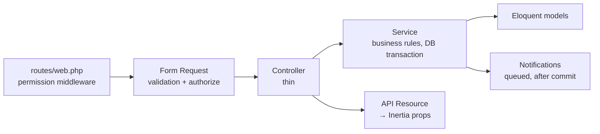

# Phase 3 — Backend

How the Laravel side of the system is organised, which rules it enforces, and how to run its background parts.

---

## 1. Layers



| Layer         | Folder                                  | Responsibility                                                                                      |
| ------------- | --------------------------------------- | --------------------------------------------------------------------------------------------------- |
| Routes        | `routes/web.php`, `routes/settings.php` | URL → controller. Each group requires a permission from `App\Enums\Permission`                      |
| Form Requests | `app/Http/Requests`                     | Validation rules, friendly messages, and the record-level `authorize()` check                       |
| Policies      | `app/Policies`                          | Record-level rules, e.g. "riders only touch their own trips", "customers only see their own orders" |
| Controllers   | `app/Http/Controllers`                  | Call a service, then return `Inertia::render()` or redirect with a toast                            |
| Services      | `app/Services`                          | **All business rules.** The same code runs from controllers, commands, seeders and tests            |
| Resources     | `app/Http/Resources`                    | Decide exactly which fields reach the browser                                                       |
| Notifications | `app/Notifications`                     | SMS and email to customers; in-app alerts (bell icon) to staff                                      |

## 2. Services

| Service                | What it guarantees                                                                                                                                          |
| ---------------------- | ----------------------------------------------------------------------------------------------------------------------------------------------------------- |
| `OrderNumberGenerator` | `LND-YYYYMMDD-NNNN`, never duplicated. Today's counter row is locked (`SELECT … FOR UPDATE`) while the number is taken                                      |
| `PricingService`       | Applies the minimum kg, express surcharge (from Settings), delivery fee and discount, and computes the due date. **Totals sent by the browser are ignored** |
| `OrderService`         | Creates or edits an order in one transaction: customer (reused when the phone already exists), items, totals, schedule, first payment and history           |
| `OrderStatusService`   | The only way a status changes. Enforces the state machine and the rules in §3, writes the history row, syncs the delivery trip and notifies the customer    |
| `PaymentService`       | Records payments (no overpaying; cash change is computed; e-wallets need a reference number) and voids them. Keeps `amount_paid` / `payment_status` in sync |
| `DeliveryService`      | Schedules trips and assigns riders, plus the rider's Start / Done / Failed actions                                                                          |
| `InventoryService`     | Writes the stock ledger and blocks negative stock. Sends a low-stock alert the moment an item crosses its reorder level                                     |
| `ReportService`        | Every number on the dashboard, report pages, PDF and Excel. Works on both MariaDB and SQLite                                                                |
| `QrCodeService`        | QR codes for bag tags and receipts (SVG)                                                                                                                    |

## 3. Business rules enforced on the server

| Rule                                                                                                                      | Where                                             |
| ------------------------------------------------------------------------------------------------------------------------- | ------------------------------------------------- |
| Status moves only along the allowed paths (no skipping, no going back)                                                    | `OrderStatus::allowedTransitions()`               |
| Double-scanning a tag cannot skip a step (the order row is locked)                                                        | `OrderStatusService`                              |
| A pickup booking must be weighed before it is marked _Received_; receiving it starts the due-date clock                   | `OrderStatusService`                              |
| An order cannot be _Completed_ or _Delivered_ while it has a balance. Only the owner can override, and must give a reason | `OrderStatusService`                              |
| Cancelling needs a reason; orders that have payments must have them voided first                                          | `OrderStatusService`                              |
| A failed delivery returns the order to _Ready_ and needs a reason                                                         | `OrderStatusService`                              |
| Items can be edited only before washing starts, and the new total may not fall below the amount already paid              | `OrderPolicy`, `OrderService`                     |
| A payment can never exceed the balance; cash handed over must cover the amount                                            | `PaymentService`                                  |
| A mobile number is unique per customer: `+63 917…`, `0917-…` and `917…` count as the same number                          | `Customer::normalizePhone`, `SaveCustomerRequest` |
| Deactivated staff cannot log in and are signed out immediately                                                            | `FortifyServiceProvider`, `EnsureUserIsActive`    |
| The owner cannot remove their own Admin role or deactivate their own account                                              | `SaveUserRequest`, `UserController`               |
| Public tracking uses a random 12-character code, never the guessable order number                                         | `TrackingController`                              |

## 4. Route map (by role)

| Area              | Routes                                                                         |         Admin         |    Cashier     |     Staff      |    Rider     | Customer |
| ----------------- | ------------------------------------------------------------------------------ | :-------------------: | :------------: | :------------: | :----------: | :------: |
| Dashboard         | `GET /dashboard`                                                               |       analytics       |      ops       |      ops       | → rider page | → portal |
| Customers         | `/customers` (CRUD)                                                            |          ✅           | ✅ (no delete) |      view      |              |          |
| Orders            | `/orders`, `/orders/board`, `/orders/create`, `/orders/{id}`                   |          ✅           |       ✅       |      view      |              |          |
| Status            | `POST /orders/{id}/status`                                                     |          ✅           |       ✅       | ✅ (no cancel) |              |          |
| Scan              | `/scan`, `/scan/{orderNumber}`                                                 |          ✅           |       ✅       |       ✅       |              |          |
| Receipt & tag     | `/orders/{id}/receipt`, `receipt.pdf`, `tag.pdf`                               |          ✅           |       ✅       |       ✅       |              |          |
| Payments          | `/payments`, `POST /orders/{id}/payments`, `POST /payments/{id}/void`          |          ✅           |  ✅ (no void)  |                |              |          |
| Deliveries        | `/deliveries`, `POST /orders/{id}/deliveries`                                  |          ✅           |       ✅       |                |              |          |
| Rider             | `/rider/deliveries` + start/complete/fail                                      |                       |                |                |    ✅ own    |          |
| Monitoring        | `/monitoring/overdue`, `/monitoring/unclaimed`, `POST /orders/{id}/remind`     |          ✅           |       ✅       |      view      |              |          |
| Services          | `/services`                                                                    |          ✅           |                |                |              |          |
| Inventory         | `/inventory`, `/inventory/{id}`, movements                                     |          ✅           |      view      |   stock-out    |              |          |
| Reports           | `/reports`, `/reports/staff`, `/reports/export/{sales,services,staff,pending}` |          ✅           |                |                |              |          |
| Daily summary     | `/reports/daily`, `/reports/export/daily`                                      |          ✅           |       ✅       |                |              |          |
| Users             | `/users`                                                                       |          ✅           |                |                |              |          |
| Activity log      | `/activity-log`                                                                |          ✅           |                |                |              |          |
| Shop settings     | `/settings/shop`                                                               |          ✅           |                |                |              |          |
| Search (JSON)     | `GET /search?q=`                                                               |          ✅           |       ✅       |       ✅       |              |          |
| Portal            | `/portal`, `/portal/book`, `/portal/orders/{id}`                               |                       |                |                |              |  ✅ own  |
| Tracking (public) | `GET /track/{code}`                                                            | anyone (rate-limited) |

`GET /search` is the only endpoint that returns JSON. The Ctrl+K palette and the customer combobox query it on every keystroke, and a full page visit per keypress would be wasteful.

## 5. Notifications

| Notification          | Sent to          | Channels       | Trigger                                     |
| --------------------- | ---------------- | -------------- | ------------------------------------------- |
| `OrderReceived`       | Customer         | SMS + email    | Walk-in order saved, or a pickup weighed in |
| `OrderReady`          | Customer         | SMS + email    | First time an order reaches _Ready_         |
| `OrderOutForDelivery` | Customer         | SMS + email    | Rider starts the trip                       |
| `OrderCompleted`      | Customer         | SMS + email    | Claimed at the counter or delivered         |
| `UnclaimedReminder`   | Customer         | SMS + email    | Daily schedule, or the _Remind_ button      |
| `OverdueOrdersDigest` | Owner + cashiers | In-app         | 8 AM and 1 PM                               |
| `LowStockAlert`       | Owner            | In-app + email | Stock crosses its reorder level             |

Customer messages are:

- **Queued**, so the counter never waits for the SMS provider.
- **Sent after the database transaction commits**, so a message is never sent for an order whose save failed.
- Controlled by the _SMS enabled_ / _Email enabled_ switches in Shop Settings.

Every SMS and email is recorded in `notification_logs`, and the order page shows them.

**SMS drivers** (set in `.env`):

```dotenv
SMS_DRIVER=log            # development: messages appear in storage/logs/laravel.log
SMS_DRIVER=semaphore      # production (Philippines)
SEMAPHORE_API_KEY=your-key
SEMAPHORE_SENDER_NAME=YOURSHOP   # optional, must be approved by Semaphore
```

## 6. Background processes

```bash
# Sends queued SMS/email. Must always run (Windows: keep a terminal open, or use NSSM/Task Scheduler).
php artisan queue:work --tries=3

# Runs the scheduled tasks below. Linux cron: * * * * * php /path/artisan schedule:run
php artisan schedule:work
```

| Schedule            | Command                            | Purpose                                                                    |
| ------------------- | ---------------------------------- | -------------------------------------------------------------------------- |
| 8:00 AM and 1:00 PM | `laundry:notify-overdue`           | In-app alert listing late laundry                                          |
| 9:00 AM daily       | `laundry:send-unclaimed-reminders` | Reminder after _unclaimed_after_days_, then every _reminder_interval_days_ |
| Monthly             | `activitylog:clean`                | Removes audit entries older than 365 days                                  |

Both laundry commands can be run by hand. `--dry-run` lists the orders that would be reminded without sending anything.

## 7. PDF, Excel and QR

| Output        | Route                                                 | Format                                                                    |
| ------------- | ----------------------------------------------------- | ------------------------------------------------------------------------- |
| Receipt       | `/orders/{id}/receipt.pdf`                            | 80 mm thermal roll; page length grows with the number of items            |
| Bag tag       | `/orders/{id}/tag.pdf`                                | 4 × 3 in label; the QR opens `/scan/{orderNumber}` (staff login required) |
| Reports       | `/reports/export/{report}?format=pdf\|xlsx&from=&to=` | Sales, completed services, staff activity, pending orders                 |
| Daily summary | `/reports/export/daily?date=`                         | A4 PDF with signature lines for cashier and owner                         |

**QR library decision:** `simplesoftwareio/simple-qrcode` is abandoned and requires `bacon/bacon-qr-code` v2. Fortify's two-factor login already uses v3, so installing it would mean downgrading a security dependency. `QrCodeService` calls bacon v3 directly; that is all simple-qrcode did internally.

## 8. Tests

`php artisan test` runs 133 tests, covering:

- Every role × page access rule (20 cases)
- Order creation, sequential numbering, minimum kg, express, discount, and duplicate-customer prevention
- The status state machine: rapid double-scan, balance rule, owner override, cancellation rules, pickup weigh-in
- Payments: partial, change, overpayment, short cash, e-wallet reference, voiding
- The full delivery flow with cash on delivery, failed delivery and rescheduling, and rider isolation
- The scheduler commands, low-stock alerts, report pages, Excel/PDF exports, receipt and tag PDFs, search, monitoring, and public tracking privacy
