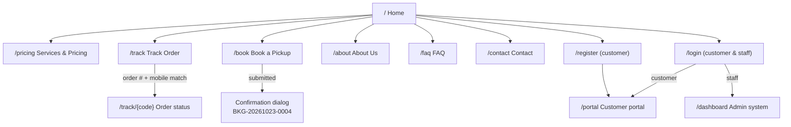
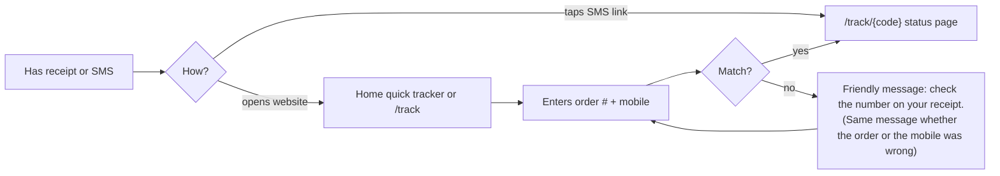
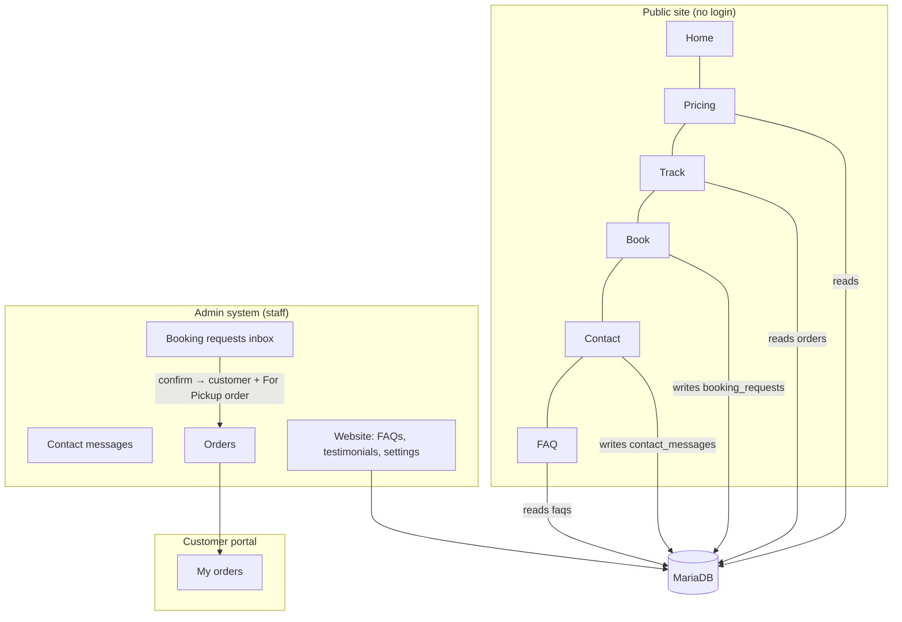
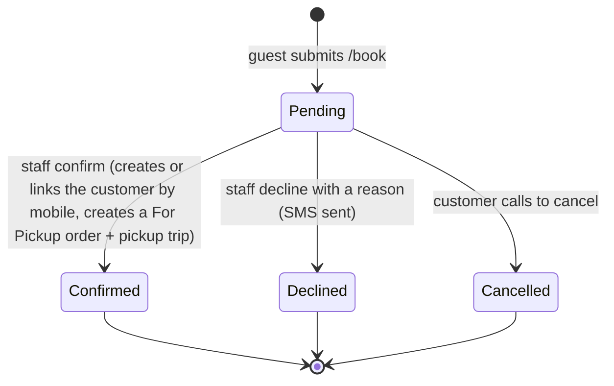

# Public Website — Phase 1: Planning

**Project:** Public landing site for the Digital Laundry Order Recording and Processing System
**Status:** Draft for approval
**Builds on:** the main system (Laravel 13 · Inertia v3 · React 19 · shadcn/ui · MariaDB). This plan reuses the main system's tables, services and theme wherever they already exist.

---

## 1. What already exists vs. what is new

The main system already covers part of this brief, so we extend it instead of building a second copy.

| Brief asks for                        | Already in the main system                                                              | Plan                                                                                                                                                        |
| ------------------------------------- | --------------------------------------------------------------------------------------- | ----------------------------------------------------------------------------------------------------------------------------------------------------------- |
| Track order without login             | `/track/{tracking_code}`: the private link sent by SMS                                  | **Add** a public form asking for _order number + mobile number_. A match redirects to the existing tracking page, so there is one result screen to maintain |
| Book a pickup                         | Portal booking for **logged-in** customers, which creates a _For Pickup_ order directly | **Add** guest booking. It saves a **booking request** that staff confirm, and the confirmed request becomes the same _For Pickup_ order                     |
| Services & pricing from the database  | `services` table, edited by the owner                                                   | **Reuse.** The public page reads the same rows, so price changes show instantly                                                                             |
| Business settings shared to all pages | `settings` key/value table plus the Shop Settings page                                  | **Extend** with website keys (tagline, hours, social links, map, about text…) and a "Website" section on the same settings page                             |
| SMS/email notifications               | Queued notifications, Semaphore SMS, `notification_logs`                                | **Reuse** the same channels for booking confirmations                                                                                                       |
| Login / register                      | Fortify `/login` and `/register`, with a role-based redirect after login                | **Reuse.** "Customer login" and "Staff login" are the same secure page                                                                                      |
| Theme, dark mode                      | Laundry Blue shadcn theme in `app.css`                                                  | **Reuse** the tokens; the public site gets marketing-sized type and spacing                                                                                 |

## 2. Sitemap



| Page                        | URL                   | Notes                                                                                                                          |
| --------------------------- | --------------------- | ------------------------------------------------------------------------------------------------------------------------------ |
| Home                        | `/`                   | Replaces the current `welcome` page                                                                                            |
| Services & Pricing          | **`/pricing`**        | Not `/services`: that URL is the admin price editor. `/pricing` also matches what people search for ("laundry price per kilo") |
| Track Order                 | `/track`              | Form. The result page stays `/track/{code}`, so SMS links keep working                                                         |
| Book a Pickup               | `/book`               | Guest form. Logged-in customers are sent to `/portal/book` with their details pre-filled                                       |
| About Us                    | `/about`              |                                                                                                                                |
| FAQ                         | `/faq`                |                                                                                                                                |
| Contact                     | `/contact`            | Form plus map                                                                                                                  |
| Customer login / register   | `/login`, `/register` | Existing pages, restyled to match the site                                                                                     |
| Staff login                 | `/login?staff=1`      | Same login (one secure entry point); the footer link only changes the heading                                                  |
| 404                         | any unknown URL       | Inertia error page in the public layout with links back to Home / Track / Book                                                 |
| `sitemap.xml`, `robots.txt` |                       | Public pages only; `robots.txt` blocks admin and portal paths                                                                  |

## 3. User journeys

### 3.1 New visitor books a pickup

```mermaid
flowchart LR
    A[Finds shop on Facebook / Google] --> B[Home: hero + prices]
    B --> C{Trust?}
    C -->|reads| D[Services, How it works, Reviews]
    D --> E[Book a Pickup]
    C -->|ready| E
    E --> F[Fills form: name, mobile, address,<br/>date + time slot, service, est. weight]
    F --> G{Slot still open?}
    G -->|no| F
    G -->|yes| H[Confirmation dialog<br/>ref BKG-20261023-0004]
    H --> I[[SMS: request received]]
    I --> J[Staff confirm in the admin system]
    J --> K[[SMS: pickup confirmed for Tue 1 PM]]
    K --> L[Rider picks up → order starts → normal tracking SMS]
```



### 3.2 Existing customer tracks an order



**Privacy rules for tracking**

- Both the order number and the mobile number must match. The mobile number is normalized, so `0917…`, `+63 917…` and `917…` all count as the same number.
- One generic "not found" message covers every mismatch, so nobody can test whether an order number exists.
- **Rate limits:** 10 lookups per minute per IP address, and 5 failed tries per order number per 15 minutes.
- The result shows only the customer's first name, the status, the schedule and the balance. It never shows the address or the full name.

### 3.3 Visitor → registered customer

Sign-up uses the **existing mobile-number linking**: registering with a mobile number that a walk-in customer already has attaches that customer's whole order history. Booking-confirmation messages invite the customer to "Create an account to track all your orders".

## 4. How the public site connects to the main system



### 4.1 Booking request lifecycle



- **Why a request instead of an order straight away:** guests are unverified, so a fake booking must not create a customer, an order number or a rider trip. Logged-in portal customers keep booking directly, because their account and mobile number are verified.
- **Staff side:** a new **Booking requests** inbox (Operations group, with a count badge). One click confirms a request and reuses `OrderService::create()`, so the pickup, the delivery fee and the notifications all behave exactly as in Phase 3 of the main system.

### 4.2 New admin pages (added to the main system)

| Page                    | Who            | Purpose                                                                                   |
| ----------------------- | -------------- | ----------------------------------------------------------------------------------------- |
| Booking requests        | Admin, Cashier | Confirm or decline guest bookings                                                         |
| Contact messages        | Admin, Cashier | Read, mark handled, reply by phone/email                                                  |
| Website → FAQs          | Admin          | Add, edit, reorder and publish questions                                                  |
| Website → Testimonials  | Admin          | Approve customer feedback before it appears publicly                                      |
| Shop settings → Website | Admin          | Tagline, hours, social links, map, about text, founding year, logo, slots per pickup time |

### 4.3 Where testimonials come from

Testimonials come from **real customer feedback**, not hand-typed quotes:

- The existing _OrderCompleted_ SMS/email gets a short link: "Rate us: /feedback/{tracking_code}".
- The customer gives 1–5 stars and a comment.
- The owner approves the best ones in _Website → Testimonials_.

The seeder adds approved sample feedback for the demo.

## 5. Key technical decisions

| #   | Decision                                                                                                                                                                                                                        | Why                                                                                                                                                                                                                                                         |
| --- | ------------------------------------------------------------------------------------------------------------------------------------------------------------------------------------------------------------------------------- | ----------------------------------------------------------------------------------------------------------------------------------------------------------------------------------------------------------------------------------------------------------- |
| D1  | **Server-rendered meta tags.** Each public controller passes title, description, Open Graph and JSON-LD to the Blade root view (`Inertia::render()->withViewData()`); `<Head>` keeps them in sync during in-app navigation      | Facebook's link preview and many crawlers do **not** run JavaScript. Tags added only by React's `<Head>` would be invisible to them. This works on XAMPP and shared hosting without running a Node SSR server. Full Inertia SSR remains an optional upgrade |
| D2  | Public tracking = order number + mobile, then redirect to `/track/{code}`                                                                                                                                                       | One result page; SMS links keep working; privacy rules live in one controller                                                                                                                                                                               |
| D3  | Home quick tracker shows its result **inline** (Inertia flash data on the same page) with "View full details"                                                                                                                   | The "instant result" the brief asks for, without adding a JSON API                                                                                                                                                                                          |
| D4  | **Time-slot capacity**: a `pickup_slot_capacity` setting (default 4 per slot). Free slots = capacity − scheduled pickups − pending requests for that date and slot. Loaded with an Inertia partial reload when the date changes | Delivers the "fully booked slots" edge case; full slots appear disabled in the form                                                                                                                                                                         |
| D5  | **Spam protection without CAPTCHA:** honeypot field, a "submitted too fast" time check (under 3 s), throttle 5 bookings/hour per IP, max 3 pending requests per mobile number                                                   | No extra service or privacy cost, invisible to real customers. Cloudflare Turnstile can be added later if spam appears                                                                                                                                      |
| D6  | **No Framer Motion.** Subtle reveals use `tw-animate-css` (already installed) plus a tiny IntersectionObserver hook                                                                                                             | Saves roughly 40 KB of JavaScript on mobile data; the brief marks motion as optional                                                                                                                                                                        |
| D7  | Trust-bar numbers come from **real data** (completed orders, customers, years since the founding year), cached for one hour                                                                                                     | Honest and automatic; nothing goes stale                                                                                                                                                                                                                    |
| D8  | "Online payment" is presented as **"Pay with GCash or Maya"**                                                                                                                                                                   | The system records e-wallet payments by reference number; it has no payment gateway. Claiming "online payment" would mislead customers. A gateway (PayMongo, Xendit) could be a later phase                                                                 |
| D9  | File names stay **kebab-case** (`public-site-layout.tsx`); component names are PascalCase (`PublicSiteLayout`)                                                                                                                  | Matches the starter kit and the shadcn CLI, which generate kebab-case files. Mixing both styles in one codebase causes import mistakes on case-sensitive Linux servers                                                                                      |

## 6. Folder structure

```
app/
├── Http/Controllers/Public/
│   ├── HomeController.php          PricingController.php
│   ├── TrackOrderController.php    BookingRequestController.php
│   ├── ContactController.php       PageController.php (about, faq)
│   ├── FeedbackController.php      SitemapController.php
├── Http/Controllers/Admin/         (new admin inbox pages)
│   ├── BookingRequestController.php  ContactMessageController.php
│   ├── FaqController.php             TestimonialController.php
├── Http/Requests/Public/           TrackOrderRequest, StoreBookingRequest, StoreContactMessageRequest, StoreFeedbackRequest
├── Models/                         BookingRequest, ContactMessage, Faq, Testimonial
├── Notifications/                  BookingReceived, BookingConfirmed, BookingDeclined, NewBookingAlert, NewContactMessage
├── Services/                       BookingService (slots, confirm/decline), SeoService (meta, JSON-LD)
resources/
├── views/app.blade.php             + server-rendered meta / OG / JSON-LD block
└── js/
    ├── layouts/public-site-layout.tsx        Navbar + Footer (replaces the bare public-layout.tsx)
    ├── components/public/
    │   ├── site-navbar.tsx  site-footer.tsx  section-header.tsx
    │   ├── hero.tsx  quick-tracker.tsx  trust-bar.tsx  service-card.tsx
    │   ├── step-card.tsx  feature-card.tsx  pricing-table.tsx
    │   ├── testimonial-card.tsx  cta-banner.tsx  faq-list.tsx  reveal.tsx
    ├── pages/public/
    │   ├── home.tsx  pricing.tsx  track.tsx  book.tsx
    │   ├── about.tsx  faq.tsx  contact.tsx  feedback.tsx
    ├── pages/errors/not-found.tsx
    └── pages/admin/ (booking-requests, contact-messages, faqs, testimonials)
routes/
└── public.php                      (included from web.php; no auth, named public.*)
```

## 7. Order of work

The main system is in **Phase 5 (frontend)** right now. Proposed order:

1. Finish the main Phase 5 (in progress).
2. Public site Phases 2 → 5 (database, backend, design and copy, frontend). They reuse the Phase 5 components (StatusBadge, OrderStepper, DatePicker…).
3. **One combined Phase 6** (testing and launch) for both: one round of feature tests, Lighthouse checks and deployment instead of two.

## 8. Questions before Phase 2

| #   | Question                                                                                                                                                   | My recommendation                                                                                                                    |
| --- | ---------------------------------------------------------------------------------------------------------------------------------------------------------- | ------------------------------------------------------------------------------------------------------------------------------------ |
| Q1  | **Business details:** shop name, tagline, city/province, hours, phone, email, Facebook page, founding year, exact address (for the map and Google listing) | Needed for real copy in Phase 4. Until then I'll seed realistic sample values that are easy to edit in Settings                      |
| Q2  | Brand colors                                                                                                                                               | Keep **Laundry Blue** (primary, same as the admin system) and add **fresh aqua** as a marketing accent for icons and highlights only |
| Q3  | Guest bookings as _requests_ that staff confirm (§4.1)                                                                                                     | Yes                                                                                                                                  |
| Q4  | Public pricing URL `/pricing` instead of `/services`                                                                                                       | Yes                                                                                                                                  |
| Q5  | Testimonials from the post-order rating link (§4.3)                                                                                                        | Yes. Sample reviews are seeded for the demo                                                                                          |
| Q6  | Slots per pickup time (D4)                                                                                                                                 | 4 per slot (9 AM / 1 PM / 4 PM), editable in Settings                                                                                |
| Q7  | Order of work (§7): finish the main Phase 5 first, then the public site, then a combined Phase 6                                                           | Yes                                                                                                                                  |
