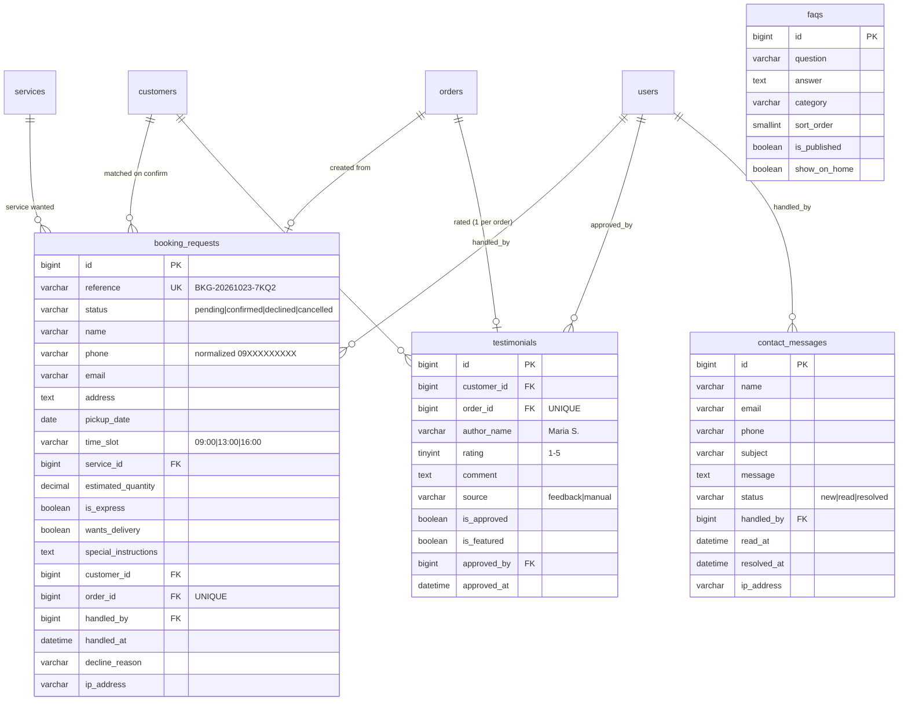

# Public Website — Phase 2: Database

Four new tables plus website keys in the existing `settings` table. Everything else the public site shows (services, prices, orders for tracking) is read from the main system's tables, so there is one source of truth.

Migration: `database/migrations/2026_10_23_110000_create_public_site_tables.php`. The migration is additive: it only creates tables, so `php artisan migrate` is safe on a database that already has data.

## 1. ERD (new tables in context)

## 2. Table notes

### `booking_requests`

A guest's pickup request from `/book`, which staff confirm or decline.

| Column                                   | Why                                                                                                                                 |
| ---------------------------------------- | ----------------------------------------------------------------------------------------------------------------------------------- |
| `reference`                              | `BKG-YYYYMMDD-XXXX`. The suffix is random and avoids 0/O and 1/I, so it can be read over the phone and can't be guessed in sequence |
| `phone`                                  | Normalized exactly like `customers.phone`. On confirm, it finds the existing customer, so no duplicate is created                   |
| `pickup_date` + `time_slot`              | The slot is the `PickupSlot` enum (`09:00`, `13:00`, `16:00`), shared with the portal and counter                                   |
| `customer_id`, `order_id`                | Empty until staff confirm. `order_id` is UNIQUE, so one request can never create two orders                                         |
| `ip_address`                             | Kept only to investigate spam                                                                                                       |
| Index `(status, pickup_date, time_slot)` | Makes the slot-capacity count fast                                                                                                  |

**Slot capacity** (Phase 3 `BookingService`): taken places = `pending` requests for the date and slot (`BookingRequest::holdingSlot()`) + pickup trips already scheduled in that slot. A slot is full when that reaches the `pickup_slot_capacity` setting (default 4).

### `contact_messages`

Messages from the public Contact form.

- **Status:** new → read → resolved. `read_at` and `resolved_at` record when each step happened.
- **Owner inbox:** `ContactMessage::unread()` feeds the inbox count badge.

### `testimonials`

Customer reviews; only approved ones appear on the website.

- **One review per order:** `order_id` is UNIQUE.
- **Where reviews come from:** they arrive from the "Rate us" link (`source = feedback`). The owner can also type one in by hand (`source = manual`).
- **Name privacy:** `author_name` is stored already shortened (`Testimonial::displayName()`), so the website never sends a full name to the browser. The surname initial respects Filipino surname particles: "Juan Dela Cruz" → **"Juan D."**, not "Juan C.".
- **Owner approval:** nothing is public until the owner approves it (`is_approved`). Featured reviews show first on Home (`Testimonial::forWebsite()`).

### `faqs`

- **Owner-managed:** questions are grouped by `category` and ordered by `sort_order`.
- **Home preview:** `show_on_home` picks at most 5 for the Home page (`Faq::forHome()`).

### `settings` (existing table, new keys)

Defaults live in `Setting::DEFAULTS`, so every page works even before seeding. The owner edits them in Settings → Shop (website section added in Phase 3).

| Key                                              | Example                                           |
| ------------------------------------------------ | ------------------------------------------------- |
| `shop_tagline`                                   | Fresh, clean, and on time.                        |
| `shop_city`                                      | Quezon City, Metro Manila                         |
| `business_hours`                                 | Mon–Sat 7:00 AM – 8:00 PM · Sun 8:00 AM – 5:00 PM |
| `facebook_url`, `messenger_url`, `instagram_url` | Social links (empty = hidden)                     |
| `map_embed_url`, `map_link`                      | Google Maps embed and directions link             |
| `about_text`                                     | About page story                                  |
| `founded_year`                                   | 2019 → "7 years in service" on the trust bar      |
| `service_area`                                   | Pickup and delivery within 5 km of the shop       |
| `pickup_slot_capacity`                           | 4                                                 |
| `logo_path`                                      | Uploaded logo (empty = icon)                      |

**All the business details above are sample values.** Replace them with your shop's real information before launch.

## 3. Relationships added to existing models

| Model      | New relation                                                                |
| ---------- | --------------------------------------------------------------------------- |
| `Customer` | `bookingRequests()`, `testimonials()`                                       |
| `Order`    | `bookingRequest()` (the request it came from), `testimonial()` (its rating) |
| `Service`  | `bookingRequests()`                                                         |

## 4. New enums

| Enum                   | Values                                                                                               |
| ---------------------- | ---------------------------------------------------------------------------------------------------- |
| `BookingStatus`        | pending, confirmed, declined, cancelled. `holdingSlot()` lists the statuses that use up a slot place |
| `ContactMessageStatus` | new, read, resolved                                                                                  |
| `PickupSlot`           | 09:00, 13:00, 16:00. Has `label()` ("9:00 AM") and `window()` ("9:00 – 11:00 AM") for customer copy  |

## 5. Seed data

| Seeder                 | Runs in          | Contents                                                                                                           |
| ---------------------- | ---------------- | ------------------------------------------------------------------------------------------------------------------ |
| `FaqSeeder`            | All environments | 12 real FAQs in 5 categories; 5 marked for Home. Re-running updates the text but keeps the owner's publish choices |
| `PublicSiteDemoSeeder` | Demo only        | Detailed below                                                                                                     |

`PublicSiteDemoSeeder` contents:

- **10 reviews,** tied to real completed demo orders from different customers: 8 approved, 6 featured, 2 waiting for approval.
- **7 booking requests:** tomorrow 9 AM is **3 of 4 full** (to demo slot capacity), plus one declined and one cancelled.
- **4 contact messages:** new, read and resolved.

## 6. Tests

`tests/Feature/PublicSite/PublicSiteDatabaseTest.php` (7 tests) covers:

- Reference format and uniqueness.
- Phone normalization.
- Which booking statuses hold a slot.
- Display-name privacy, including Filipino surname particles.
- Website ordering of reviews.
- The 5-question cap on the Home FAQ preview.
- Settings defaults.
- Consistency of the seeded data.
